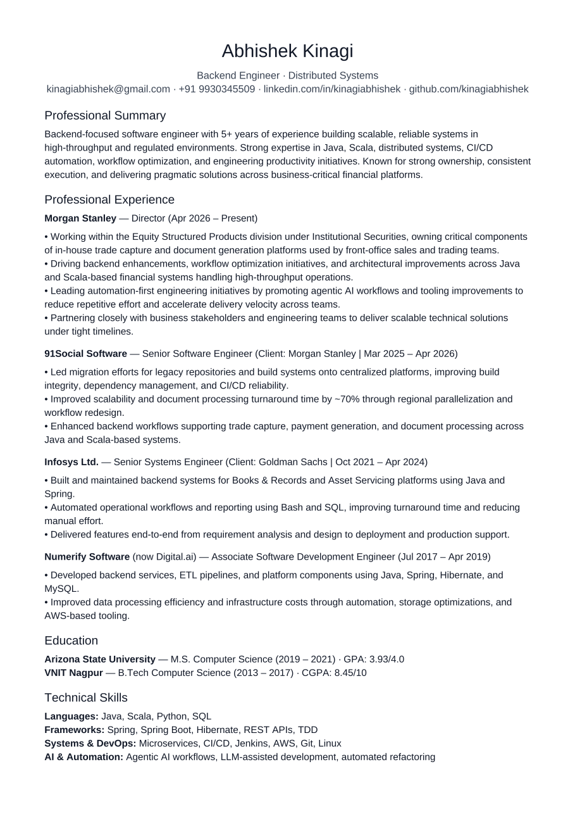

<h1 align="center">
  <a href="https://git.io/typing-svg">
    
  </a>
</h1>

<p align="center">
  
</p>

<p align="center">
  <b>Director at Morgan Stanley | Equity Derivatives Technology | Ex-Goldman Sachs | MS in CS (ASU)</b>
</p>

<p align="center">
  <a href="https://kinagiabhishek.github.io/kinagiabhishek/" target="_blank">
    
  </a>
  <a href="https://www.linkedin.com/in/kinagiabhishek/" target="_blank">
    
  </a>
  <a href="https://github.com/kinagiabhishek/code-lab">
    
  </a>
</p>

---

### 💻 Executive Overview

```yaml
name: Abhishek Kinagi
role: Director P3
company: Morgan Stanley
division: Equity Derivatives Technology / Equity Structured Products
education:
  - MS in Computer Science, Arizona State University (ASU)
  - BTech in Computer Science & Engineering, VNIT Nagpur (4-Year Campus Leadership)
prior_experience:
  - Technology Analyst @ Goldman Sachs (PWM Books & Records)
  - Associate Software Developer @ Numerify (Platform & ETL)
technical_stack: Java 26, Scala, AI Agent Workflows (Claude Code, Amp, Copilot), Multi-Dependency Test Automation, Python, Sybase SQL, Bash
focus: Distributed Systems, High Throughput, Pragmatic Engineering & Automation
```

---

### 💼 Career Snapshot

- 🏦 **Morgan Stanley (Director P3 - Equity Derivatives Technology)**:
  - **In-House Document Generation (DocGen):** Architected and delivered an enterprise-grade document generation platform across distributed microservices in Java/Scala for front-office equity derivatives desks.
  - **Enterprise Monorepo Modernization:** Spearheaded multi-project codebase migration onto a centralized repository and build framework, eliminating build drift and hardening CI/CD reliability.
  - **Fast Epic Delivery via Agentic Pipelines:** Leveraged mature AI agent development workflows (Claude Code, GitHub Copilot) to convert complex derivatives engineering epics into deliverable production code in days.
  - **High-Throughput Trade Capture:** Engineered and optimized Java and Scala backends supporting high-volume, low-latency trade capture pipelines.
- 🏛️ **Goldman Sachs (Technology Analyst - Private Wealth Management)**:
  - **Books & Records & Asset Servicing:** Developed transactional applications in Java, Sybase SQL, and Bash handling critical account records.
  - **Support Automation & DB Optimization:** Automated support monitoring frameworks (reduced manual toil by **25%**) and optimized database query scans (boosted turnaround by **40%**).
- 📊 **Numerify (Associate Software Developer - Platform)**:
  - **BI Application Modeler & ETL:** Built metadata-driven data warehouse tooling with Redshift Z-Standard compression and automated restartable ETL pipelines.
  - **Cloud Cost Optimization & Spark ML:** Automated AWS RDS start/stop lifecycle hooks and provisioned Apache Spark ML model execution infrastructure.

---

### 🌟 Monorepo Spotlight

<table>
  <tr>
    <td width="100%">
      <h3 align="center">⚡ <a href="https://github.com/kinagiabhishek/code-lab">code-lab</a></h3>
      <p align="center"><i>Primary monorepo consolidating 500+ 100% verified Java algorithms, data structures, and automation scripts.</i></p>
      <ul>
        <li><b>🧮 500+ Verified Data Structures & Algos Suite</b>: 100% fully implemented Java suite with Line-1 Official Links and exact GraphQL method signatures covering <b>Trees, Graphs, Stacks/Queues, Linked Lists, Heaps, Backtracking, DP, Sliding Window, Binary Search, & Bit Manipulation</b> (<a href="https://github.com/kinagiabhishek/code-lab/tree/master/ds-algo/java">Core Java DS</a> • <a href="https://github.com/kinagiabhishek/code-lab/tree/master/ds-algo/leetcode-practice/java">Java LeetCode Suite</a>)</li>
        <li><b>🤖 Automations</b>: Selenium & Playwright browser scripts (<a href="https://github.com/kinagiabhishek/code-lab/tree/master/automations/resume-uploader">Resume Uploader</a>)</li>
        <li><b>🐍 Python Solvers</b>: Logical constraint resolution tools (<a href="https://github.com/kinagiabhishek/code-lab/tree/master/scripts/verity-solver">Verity Solver</a>)</li>
      </ul>
    </td>
  </tr>
</table>

---

### 📊 GitHub Analytics

<p align="center">
  
  &nbsp;&nbsp;
  
</p>

---

<p align="center">
  🌐 <b>Portfolio</b>: <a href="https://kinagiabhishek.github.io/kinagiabhishek/">kinagiabhishek.github.io</a> • 
  💼 <b>LinkedIn</b>: <a href="https://www.linkedin.com/in/kinagiabhishek/">kinagiabhishek</a> • 
  📧 <b>Email</b>: <a href="mailto:kinagiabhishek@gmail.com">kinagiabhishek@gmail.com</a>
</p>
